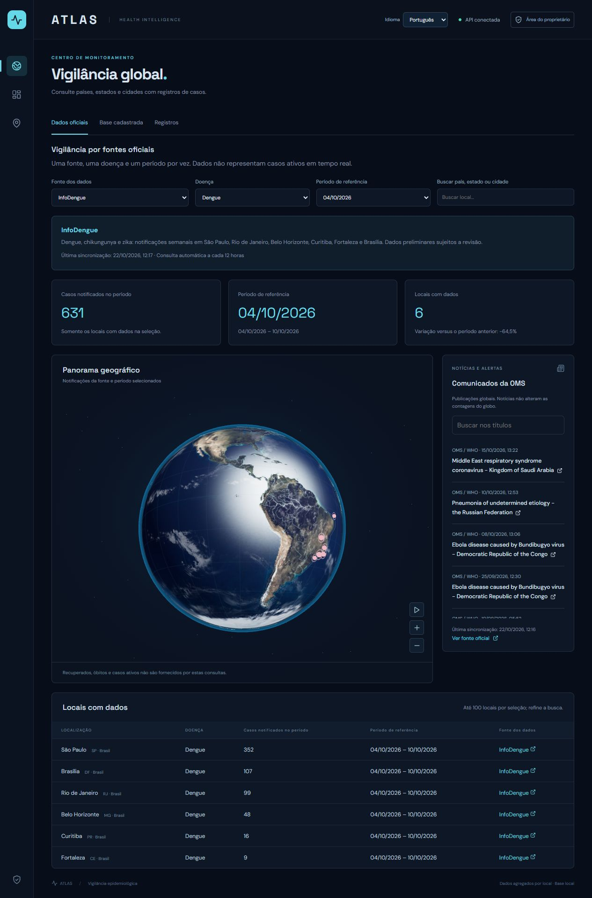

# Atlas Health — Monitoramento Epidemiológico

Epidemiological monitoring platform featuring an interactive 3D globe, official health data, and outbreak news. Built with React and Java, with support for Portuguese, English, and German.

Plataforma de monitoramento epidemiológico com globo 3D, consulta de dados públicos, notícias de surtos e administração de registros por região.

**React 18 · Java 17 · Spring Boot · Three.js · H2**

[Visão geral](#visão-geral) · [Fontes reais](#fontes-reais-e-integrações) · [Executar](#como-executar) · [API](#api) · [Autor](#autor)

## Prévia do sistema



*Captura real do aplicativo, feita em 22/10/2026. Os números correspondem ao período selecionado na imagem e não representam uma contagem ao vivo.*

## Visão geral

O Atlas reúne observações epidemiológicas de fontes públicas e as apresenta com localização, doença, período de referência e origem. A home é pública; somente o proprietário precisa entrar para cadastrar, importar ou administrar as sincronizações.

### Funcionalidades

- Globo 3D interativo com texturas da Terra, nuvens, atmosfera, fronteiras e marcadores geográficos.
- Consulta de notificações por fonte, doença, período e busca por país, estado ou cidade.
- Detalhes do local selecionado e link para a fonte original.
- Sincronização automática em segundo plano, cache persistente e status de atualização.
- Notícias e alertas da OMS na lateral, com busca por título e link do comunicado.
- Cadastro de registros agregados e importação JSON com validação e prévia antes da publicação.
- Histórico de observações, atualização sem duplicação e exportação CSV da base cadastrada.
- Área do proprietário com autenticação, controle de sincronizações e exclusão de registros próprios.
- Interface em **português, inglês e alemão**, incluindo formatos de datas, números e percentuais.

### Organização dos dados

| Área | Conteúdo |
| --- | --- |
| **Dados oficiais** | Observações sincronizadas da OMS/GHO e do InfoDengue, consultadas por fonte e período. |
| **Base cadastrada / Registros** | Cadastros do proprietário, importações JSON e a integração opcional de COVID-19. |
| **Notícias e alertas** | Comunicados de surtos publicados pela OMS, em seu idioma original. |

A home abre em **Dados oficiais**. Se não houver registros próprios, a visão geral da base cadastrada direciona para os dados das APIs. Notícias não são convertidas automaticamente em números de casos.

## Fontes reais e integrações

Os intervalos abaixo são os agendamentos implementados no Atlas. Eles não mudam a frequência de publicação de cada provedor.

| Fonte | Dados utilizados no sistema | Consulta no Atlas | Situação |
| --- | --- | --- | --- |
| [OMS / Global Health Observatory](https://www.who.int/data/gho/info/gho-odata-api) | Casos notificados de sarampo, coqueluche e difteria, por país e ano. | A cada 24 horas | Integrada; habilitada por padrão. |
| [InfoDengue](https://info.dengue.mat.br/services/api) | Notificações semanais de dengue, chikungunya e zika, quando disponíveis, nos municípios configurados. | A cada 12 horas | Integrada; habilitada por padrão. |
| [OMS / Disease Outbreak News](https://www.who.int/emergencies/disease-outbreak-news) | Até 30 comunicados recentes, com título, data e link oficial. | A cada 30 minutos | Integrada; habilitada por padrão. |
| [disease.sh](https://disease.sh/docs/) | Totais nacionais de COVID-19, com a data informada pelo provedor. | Manual ou a cada 6 horas | Opcional; sincronização automática desativada por padrão. Não é uma API da OMS. |
| [Ministério da Saúde / SINAN](https://dadosabertos.saude.gov.br/dataset/arboviroses-dengue) | Monitoramento de conectividade da API oficial. | Verificação programada; nova tentativa após falha em 30 minutos. | **Importação numérica pendente.** Não publica contagens no Atlas. |

### OMS / GHO

A integração usa a API OData e os indicadores:

| Indicador | Doença | Unidade |
| --- | --- | --- |
| `WHS3_62` | Sarampo | Casos notificados por país e ano |
| `WHS3_43` | Coqueluche | Casos notificados por país e ano |
| `WHS3_41` | Difteria | Casos notificados por país e ano |

São consultados os três anos anteriores completos. O importador usa a dimensão `COUNTRY`, sem somar estratificações adicionais. Valores ausentes e locais sem referência geográfica são omitidos, não convertidos em zero. Esses indicadores anuais não mostram casos ativos de hoje.

### InfoDengue

O conector utiliza diretamente a API pública `https://info.dengue.mat.br/api/alertcity`. O Atlas não depende da API autenticada do Mosqlimate nem exige sua chave para essa integração.

Cobertura municipal inicial:

| Município | UF | Código IBGE |
| --- | --- | --- |
| São Paulo | SP | `3550308` |
| Rio de Janeiro | RJ | `3304557` |
| Belo Horizonte | MG | `3106200` |
| Curitiba | PR | `4106902` |
| Fortaleza | CE | `2304400` |
| Brasília | DF | `5300108` |

O sistema consulta o ano corrente e o anterior, usa `casos` — notificações — e não substitui esses valores por `casos_est`, que são estimativas. Somente registros com `Localidade_id = 0` são utilizados, evitando somar o total municipal com suas subdivisões. Dados semanais são preliminares e podem receber revisões. A cobertura atual não inclui todos os municípios brasileiros.

### SINAN: limite atual

A conexão com a API do Ministério da Saúde falhou no ambiente de desenvolvimento. O contrato de resposta e a paginação ainda precisam ser validados; **o importador numérico SINAN não está implementado**. O sistema mostra essa pendência e preserva os dados das demais fontes. Restaurar a conexão, sozinho, não ativa a importação.

O InfoDengue já utiliza dados de notificações do SINAN. Uma futura integração direta deverá considerar essa sobreposição para evitar contagem duplicada.

## Como os dados são atualizados

1. O backend verifica tarefas de sincronização após a inicialização e, depois, a cada minuto.
2. As consultas numéricas oficiais são processadas em uma fila em segundo plano.
3. O lote é validado e salvo em uma transação. Reimportar a mesma fonte, local, doença e período atualiza a observação existente.
4. Uma falha preserva o cache e a última sincronização bem-sucedida. Há nova tentativa após 30 minutos.
5. A home de dados oficiais consulta o cache a cada 30 segundos; as notícias são consultadas pela interface a cada 5 minutos.

**O backend precisa permanecer ligado para sincronizar.** A data de sincronização indica quando o Atlas consultou a fonte; o período de referência indica a quais semanas ou anos os números pertencem.

## Tecnologias

| Camada | Tecnologias |
| --- | --- |
| Frontend | React 18.2, Vite 4.5.14, JavaScript, CSS, Lucide |
| Visualização | Three.js 0.149, OrbitControls, TopoJSON |
| Backend | Java 17, Spring Boot 3.5.7, Spring Web, Spring Data JPA |
| Autenticação | Spring Security, BCrypt, sessões e CSRF |
| Persistência | H2 em arquivo local |
| Verificação | JUnit, Spring Boot Test, MockMvc e verificações JavaScript |

## Como executar

### Requisitos

- Node.js e npm. O frontend foi validado no **Node 14.21.3**, preservando a compatibilidade com o ambiente original.
- **JDK 17** e **Maven 3.6.3 ou superior** para o backend.
- Navegador com WebGL para o globo 3D; os dados também podem ser consultados na tabela.
- Conexão à internet para sincronizar as fontes externas.

O Node 14 é legado. Antes de atualizar as dependências ou preparar uma publicação, valide a migração para uma versão suportada do Node.

### Instalação pelo terminal

```bash
git clone https://github.com/samaelsimoes/atlas-health-epidemiologico.git
cd atlas-health-epidemiologico
```

Em um terminal, inicie o backend:

```bash
cd backend
mvn spring-boot:run
```

Em outro terminal, a partir da raiz do projeto, inicie o frontend:

```bash
cd frontend
npm install
npm run dev
```

Abra o endereço informado pelo Vite, normalmente **http://127.0.0.1:5173/#official**. O backend usa **http://127.0.0.1:8085** e o frontend encaminha `/api` para essa porta. Se a porta do frontend estiver ocupada, use o endereço exibido no terminal.

### Scripts do Windows

Na raiz, execute `iniciar-backend.cmd` e `iniciar-frontend.cmd`. Os scripts aproveitam JDK e Maven portáteis em `.tools` quando presentes. Essa pasta é ignorada pelo Git; em um clone novo, configure Java e Maven no ambiente.

### Backend no IntelliJ IDEA

1. Abra `backend/pom.xml` como projeto Maven.
2. Selecione JDK 17 como SDK e como JDK do Maven.
3. Execute `br.com.atlas.AtlasApplication`.
4. Inicie o frontend separadamente. Execute somente uma instância do backend na porta 8085.

## Acesso do proprietário

A consulta pública não exige conta. Para administrar, abra **Área do proprietário** (`/#admin`).

Na primeira execução, configure seu nome, e-mail e senha de pelo menos **12 caracteres**, respeitando o limite de **72 bytes**. Não existem credenciais padrão. Após a configuração inicial, o acesso usa e-mail e senha.

As senhas são armazenadas como hash BCrypt. Mutações exigem autenticação e CSRF; a sessão utiliza cookie HttpOnly e SameSite=Strict. Há limite de tentativas de login e expiração de sessão após 30 minutos de inatividade. Esta versão oferece uma conta proprietária e não inclui recuperação de senha por e-mail.

## Cadastro e importação JSON

Em **Importação e fontes**, cadastre registros ou importe um JSON. Use **Validar e visualizar** para revisar sem gravar, depois **Publicar no globo** para confirmar a importação.

O [modelo de importação](examples/importacao-modelo.json) contém dados fictícios e deve ser substituído pelos dados da sua fonte. A interface aceita arquivos de até 2 MB e o backend aceita até 2.000 registros por lote.

Campos obrigatórios: `country`, `city`, `virus`, `latitude`, `longitude`, `cases`, `recovered`, `deaths` e `date` (`AAAA-MM-DD`). `state` é opcional. `classification` aceita `Doença`, `Surto`, `Epidemia` ou `Pandemia`; o padrão é `Doença`.

Esses valores do contrato JSON permanecem iguais nos três idiomas. A classificação deve vir da fonte ou do proprietário; não é calculada a partir da quantidade de casos. Lotes inválidos não são publicados parcialmente.

## Persistência e interpretação

O banco é salvo em `~/.atlas-health/atlas.mv.db` — no Windows, `%USERPROFILE%\.atlas-health\atlas.mv.db`. Fica fora do repositório e mantém os dados entre reinicializações. Faça backup da pasta `.atlas-health` com o backend parado.

- Compare uma fonte, uma doença e um período por vez. Totais de fontes, países e cidades podem se sobrepor.
- Notificações, confirmações e estimativas não são medidas equivalentes.
- Ausência de dados não significa zero. Um zero publicado pela fonte é diferente de um valor indisponível.
- Recuperados, óbitos e casos ativos não são fornecidos pelas consultas GHO/InfoDengue utilizadas; o painel oficial não inventa esses totais.
- Na base cadastrada, casos ativos são calculados a partir dos totais informados: confirmados menos recuperados e óbitos.
- Marcadores nacionais usam coordenadas de capital como referência geográfica. Não representam um surto restrito àquela cidade.
- Pontos no globo representam registros agregados. Não indicam contaminação de toda uma região nem calculam risco clínico.

## Estrutura do repositório

```text
backend/             API Java, conectores, autenticação e testes
frontend/            Interface React e recursos do globo
  public/            Texturas e fronteiras geográficas
  scripts/           Verificações de idioma e comparações
docs/images/         Capturas utilizadas neste README
examples/            Modelo JSON para importação
iniciar-backend.cmd  Inicialização no Windows
iniciar-frontend.cmd Inicialização no Windows
```

## API

| Método | Rota | Acesso / finalidade |
| --- | --- | --- |
| GET | `/api/health` | Público; saúde do backend |
| GET | `/api/surveillance?source=infodengue` | Público; observações e status. Aceita `gho`, `infodengue` ou `sinan`. |
| GET | `/api/news` | Público; comunicados da OMS em cache |
| GET | `/api/records` | Público; registros da base cadastrada |
| GET | `/api/auth/status` | Público; informa se o proprietário já foi configurado |
| POST | `/api/auth/setup` | Configuração inicial, disponível enquanto não houver proprietário; exige CSRF |
| POST | `/api/auth/login` | Login por formulário; exige CSRF |
| PUT | `/api/surveillance/{source}` | Proprietário; habilita ou pausa uma fonte |
| POST | `/api/surveillance/{source}/refresh` | Proprietário; enfileira sincronização e retorna HTTP 202 |
| GET / PUT | `/api/feeds` | Proprietário; preferências de notícias e COVID-19 |
| POST | `/api/feeds/news/refresh` | Proprietário; atualiza notícias |
| POST / DELETE | `/api/records` / `/api/records/{id}` | Proprietário; cadastro e exclusão |
| POST | `/api/imports/preview` / `/api/imports/json` | Proprietário; prévia e publicação de JSON |
| POST | `/api/imports/covid` | Proprietário; importação opcional de COVID-19 |

Todas as mutações exigem CSRF. O token e o nome do cabeçalho podem ser obtidos em `GET /api/auth/csrf`, mantendo o cookie de sessão.

## Verificações

No diretório `frontend`:

```bash
npm run build
node scripts/check-analytics.mjs
node scripts/check-i18n.mjs
```

No diretório `backend`:

```bash
mvn -Datlas.feeds.initial-delay=3600000 test
```

A propriedade acima adia o agendador durante os testes. A suíte cobre autenticação, CSRF, validação, importação transacional, revisão sem duplicação, períodos, agendamento e preservação de dados após falhas.

## Padrão de código

A formatação é definida por `.editorconfig` e `.prettierrc.json`: dois espaços no frontend e quatro no Java. O Prettier e o plugin Java estão fixados em versões verificadas com Node 14.21.3.

Execute na pasta `frontend` para formatar HTML, JavaScript, JSX, CSS, JSON e Java:

```bash
npm run format
npm run format:check
```

O primeiro comando aplica o padrão; o segundo verifica sem modificar arquivos. As explicações de fontes, limitações e operação ficam neste README.

## Solução de problemas

| Sintoma | O que conferir |
| --- | --- |
| Dados oficiais ainda vazios | Aguarde a primeira sincronização, verifique internet, fonte, doença, período e status exibido. |
| Somente a base cadastrada está vazia | Use Dados oficiais; a base própria depende de cadastros ou importações. |
| API desconectada ou rotas novas retornam 401 | Confirme a porta 8085 e execute a versão atual do backend. |
| Porta 8085 ocupada | Verifique se já existe outra instância do Atlas antes de iniciar mais uma. |
| SINAN indisponível | A integração numérica está pendente; OMS e InfoDengue funcionam independentemente. |
| Globo não é renderizado | Confira suporte a WebGL e consulte os dados na tabela. |
| Maven utiliza configurações corporativas | Verifique `backend/.mvn/maven.config`, que aponta para as configurações locais do projeto. |

## Créditos e recursos

- Dados epidemiológicos: OMS/GHO, InfoDengue e integração opcional disease.sh, conforme a tabela de fontes.
- Comunicados: [WHO Disease Outbreak News](https://www.who.int/emergencies/disease-outbreak-news).
- Referências geográficas de países: [World Bank Country API](https://api.worldbank.org/v2/country?format=json&per_page=400), usadas no arquivo `country-locations.json`.
- Fronteiras: [world-atlas 2.0.2](https://github.com/topojson/world-atlas), derivado de Natural Earth.
- Texturas da Terra: [exemplos do Three.js r149](https://github.com/mrdoob/three.js/tree/r149/examples/textures/planets), distribuídas em `frontend/public/textures`.
- Ícones: [Lucide](https://lucide.dev/). Fontes: DM Sans e Space Grotesk.

O Atlas é um projeto independente e não é um produto oficial da OMS, do Ministério da Saúde ou dos demais provedores. Os dados e recursos de terceiros seguem seus respectivos termos de uso e atribuição.

## Escopo atual

Aplicação configurada para execução local em `127.0.0.1`, com banco H2 e uma conta proprietária. Hospedagem pública, HTTPS, banco de produção, recuperação de senha e múltiplos perfis ainda precisam de implementação ou configuração específica. O projeto não inclui dados pessoais de pacientes.

## Autor

**Developed by Samael Pereira Simoes**

[GitHub](https://github.com/samaelsimoes) · [Repositório](https://github.com/samaelsimoes/atlas-health-epidemiologico)
